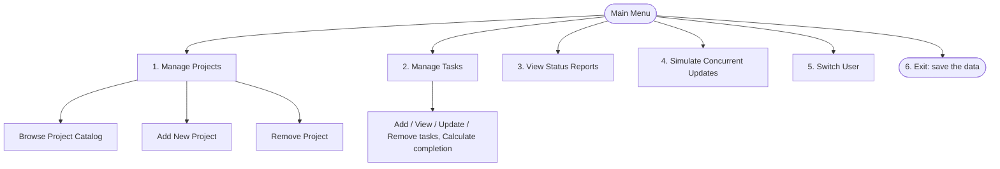
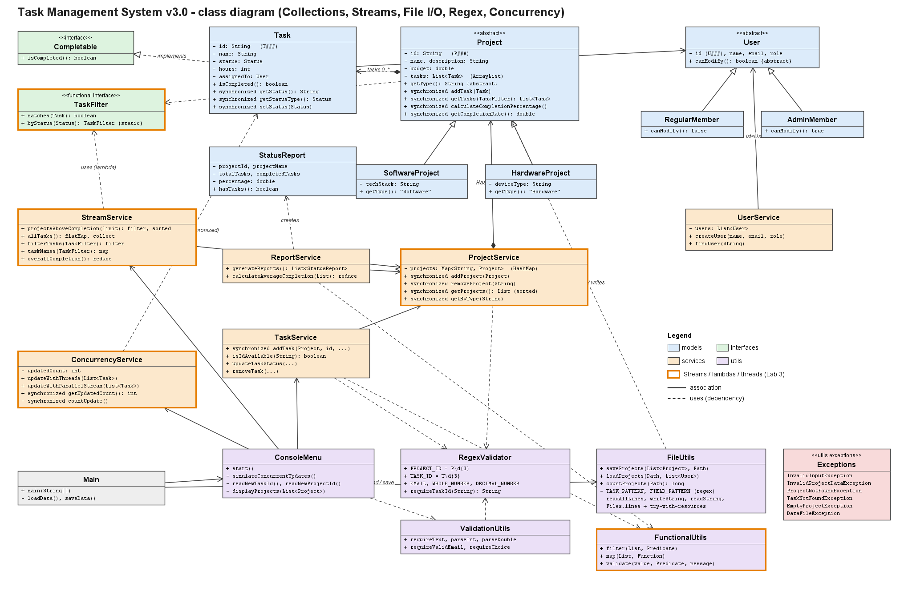

# Task Management System (Lab 3)

A console project and task manager in Java 21. You can create projects, add tasks, give them to users, change their status and see how complete each project is.

**This lab is the next step of Lab 2.** It starts from the Lab 2 code ([task-management-system-lab-2](https://github.com/josephus-mupanda/task-management-system-lab-2)) and keeps all its features. Lab 3 adds five things on top of it: collections, functional programming, regex validation, file persistence and concurrency.

## Contents

1. [From Lab 2 to Lab 3](#from-lab-2-to-lab-3)
2. [How to run](#how-to-run)
3. [Running the tests](#running-the-tests)
4. [Using the program](#using-the-program)
5. [Sample console output](#sample-console-output)
6. [The data file](#the-data-file)
7. [Class diagram](#class-diagram)
8. [Lab requirements and where they are](#lab-requirements-and-where-they-are)
9. [Git workflow](#git-workflow)
10. [Project structure](#project-structure)
11. [Known limits](#known-limits)

## From Lab 2 to Lab 3

### Kept from Lab 2

These parts work the same way as in Lab 2:

- the features: project catalog, tasks, status reports, users and switching user;
- the roles: a regular member can view and add, an admin can also update and remove (`canModify()`);
- the five custom exceptions and the way they are handled: a typing mistake is asked again, a failed operation shows the error and returns to the menu;
- the layers: models check the data, services do the work, `ConsoleMenu` reads the keyboard and prints;
- the main Lab 2 tests (completion %, empty project, adding and updating tasks), updated to the new IDs.

### New in Lab 3

| Lab 3 feature | What was added | Where |
|---|---|---|
| 1. Collections and Streams | projects in a `HashMap`, tasks in an `ArrayList`; catalog filter "Completed Projects (above 70%)"; remove a project | `ProjectService`, `Project`, **`StreamService`** |
| 2. Regex and functional validation | IDs typed by the user and checked with `P\d{3}` / `T\d{3}`; numbers and email checked with regex; `Predicate` for task ID uniqueness; functional interface for filtering | **`RegexValidator`**, **`TaskFilter`**, **`FunctionalUtils`**, `TaskService` |
| 3. File persistence | load `data/projects_data.json` on startup, save it on exit, errors for a missing or malformed file | **`FileUtils`**, **`DataFileException`**, `Main`, **`data/projects_data.json`** |
| 4. Concurrency | main menu option "Simulate Concurrent Updates" with threads or a parallel stream; `synchronized` methods | **`ConcurrencyService`**, `Project`, `Task`, `ProjectService`, `TaskService` |
| 5. Testing and Git | one test per Lab 3 requirement: streams, files, regex, threads; one Git branch per feature | **`StreamOperationsTest`**, **`FilePersistenceTest`**, `TaskTest`, `ProjectTest` |

Names in **bold** are new files. The others existed in Lab 2 and were changed.

### Changed from Lab 2

| Topic | Lab 2 | Lab 3 |
|---|---|---|
| Storage | arrays | `HashMap<String, Project>` and `ArrayList<Task>` |
| Searching | `for` loops | `stream()` with `filter`, `map`, `sorted`, `collect`, `reduce` |
| IDs | created by the program (`PRJ001`, `TSK001`), `1` was accepted for `PRJ001` | typed by the user and checked with a regex: `P001`, `T001`, nothing is converted |
| Persistence | none, the data was lost on exit | `data/projects_data.json` |
| Concurrency | none | threads and a parallel stream |
| Main menu | 5 options | 6 options: "Simulate Concurrent Updates" is added |
| Errors | `❌ Error: ExceptionName – message` | `✗ Error: message` (the format of the Lab 3 sheet) |
| Users | `RegularUser`, `AdminUser` | `RegularMember`, `AdminMember` (names of the Lab 3 structure) |
| Tests | 30 in `test/` (3 files, `*Tests`) | 23 in `tests/` (the 4 files of the Lab 3 structure), one per requirement |

More details are in [design-decisions.md](docs/design-decisions.md).

## How to run

You need JDK 21 and IntelliJ IDEA.

In IntelliJ:

1. Open the project folder.
2. Click **Load Maven Project** when IntelliJ asks. This adds JUnit 5.
3. Make sure the project SDK is JDK 21.
4. Run `Main`. The working directory must be the project folder, because the data file is `data/projects_data.json`.

If the box characters or ✓ / ✗ show as question marks, add `-Dstdout.encoding=UTF-8` to the VM options of the run configuration.

From a terminal, in the project folder:

```bash
javac -encoding UTF-8 -d out $(find src -name "*.java")
java -Dstdout.encoding=UTF-8 -cp out Main
```

You start as **Admin**. **Josephus Mupanda (Regular)** also exists. The users are not saved in the file.

## Running the tests

In IntelliJ, right click the `tests` folder and choose **Run 'All Tests'**. Or run `mvn test`.

You should get 23 tests passing. Each test checks one requirement of the lab sheet.

| Test class | Lab | What it tests |
|---|---|---|
| `ProjectTest` | 2, updated | completion % (Lab 2), empty project, `P###` regex (US-2.2), duplicate ID, remove a project and sorted catalog (Feature 1, `HashMap`) |
| `TaskTest` | 2, updated | add and update a task (Feature 2), `T###` regex (US-2.1), unique ID with a `Predicate` (Workflow 2), threads, parallel stream, exact count with 200 threads (US-4.1, US-4.2) |
| `StreamOperationsTest` | 3, new | the lab's JUnit example as written, `filter`, `map`, `reduce` (Test Scenario 8), completed projects (US-1.2) |
| `FilePersistenceTest` | 3, new | save then load (US-3.1), project count with `Files.lines` (Feature 3), missing file, malformed file (Test Scenario 6) |

## Using the program



IDs must be typed exactly with the pattern: `P001` for projects, `T001` for tasks, `U001` for users (`1` or `PRJ001` are refused). Where the prompt says so, `0` cancels.

## Sample console output

Startup (the data file is loaded):

```
╔════════════════════════════════════════╗
║  JAVA PROJECT MANAGEMENT SYSTEM v3.0   ║
╚════════════════════════════════════════╝

Loading projects from file...
✓ 5 projects loaded successfully from projects_data.json
```

Project catalog, filter 5 (Streams: projects above 70%, most completed first):

```
──────────────────────────────────────────────────────────────────
 ID     │ PROJECT NAME         │ TYPE      │ TASKS │ COMPLETED (%)
──────────────────────────────────────────────────────────────────
 P005   │ Study Planner        │ Software  │ 2     │ 100%
 P001   │ Budget Buddy         │ Software  │ 5     │ 80%
──────────────────────────────────────────────────────────────────
Total projects: 2
```

Adding a task with a wrong ID:

```
Enter new task ID: TX01
✗ Error: Invalid Task ID format. Use pattern T### (e.g., T001)
Please try again.

Enter new task ID: T013
Enter task name: Deploy App
...
✓ Task "Deploy App" added successfully.
```

Concurrent updates (main menu option 4, then 1):

```
╔════════════════════════════════════════╗
║    PARALLEL TASK UPDATE SIMULATION     ║
╚════════════════════════════════════════╝

1. Threads
2. Parallel stream

Enter your choice: 1
Starting 4 threads...
Thread-1 updating T005 -> In Progress
Thread-2 updating T007 -> In Progress
Thread-3 updating T009 -> Completed
Thread-4 updating T010 -> In Progress
All threads finished successfully.

✓ Task updates applied concurrently and safely.
```

Exit:

```
Goodbye.
Saving project data...
Data written to projects_data.json successfully!
```

A missing or malformed file:

```
Loading projects from file...
✗ Error: Unable to load projects_data.json (File not found)
→ Starting with empty catalog.
```

## The data file

`data/projects_data.json` is a list of projects, each with its tasks. It has the fields of the lab example (`projectId`, `name`, `type`, `tasks` with `id`, `name`, `status`) plus the other fields of a project, so nothing is lost after a restart:

```json
[
  {
    "projectId": "P001",
    "name": "Budget Buddy",
    "type": "Software",
    "description": "Personal expense and savings tracker",
    "budget": 8000.0,
    "teamSize": 3,
    "durationWeeks": 12,
    "techStack": "Java",
    "tasks": [
      {"id": "T001", "name": "Design Database", "status": "Completed", "hours": 6, "assignedTo": null},
      {"id": "T002", "name": "Build Expense Screen", "status": "Completed", "hours": 10, "assignedTo": "U002"}
    ]
  }
]
```


## Class diagram



The orange borders mark the classes where Lab 3 added Streams, lambdas and threads.

## Lab requirements and where they are

| Requirement | Where |
|---|---|
| Collections (`ArrayList`, `HashMap`) with generics | `Project` (tasks), `ProjectService` (projects), `UserService` (users) |
| Lambdas and method references | `StreamService`, `FunctionalUtils`, `ReportService`, `ConsoleMenu` |
| Streams: `filter`, `map`, `sorted`, `collect`, `reduce` | `StreamService`, `ReportService`, `Project` |
| Functional interface and `Predicate` | `TaskFilter`, `FunctionalUtils.validate` used by `TaskService.addTask` |
| Regex with `Pattern` and `Matcher` | `RegexValidator` (IDs, email, numbers), `FileUtils` (reading the file) |
| NIO file I/O and `try-with-resources` | `FileUtils`: `Files.readAllLines` (load on startup), `Files.writeString` and `Files.readString` (save, then read back to confirm), `Files.lines` in a `try-with-resources` (`countProjects`) |
| Threads, `Runnable`, `synchronized`, parallel stream | `ConcurrencyService`, `Project`, `Task`, `ProjectService`, `TaskService` |
| JUnit tests for streams, files and threads | `StreamOperationsTest`, `FilePersistenceTest`, `TaskTest` (threads) |
| Exceptions | `utils/exceptions` (the five of Lab 2 and `DataFileException`) |

## Git workflow

Each feature of the lab has its own branch, with the names asked in the submission requirements. When the tests pass, the branch is merged into `main` with `--no-ff`, so the history shows which commits came from which branch.

| Branch | Commits | Lab phase |
|---|---|---|
| `feature/collections-fp` | collections and streams, then regex validation | Phase 1 and Phase 2 |
| `feature/file-io` | save on exit, load on startup | Phase 3 |
| `feature/concurrency` | threads, parallel stream, `synchronized` | Phase 4 |

The regex validation is a second commit on `feature/collections-fp`, because Feature 2 of the lab joins regex and functional validation (the `Predicate` that checks a task ID is not used yet).

The preparation of the build (`chore`) and the final documentation (`docs`) are committed directly on `main`.

Working on a branch:

```bash
git checkout -b feature/file-io
git add src tests data
git commit -m "feat(io): keep projects between runs" -m "Without a file, everything typed was lost when the program closed."
git checkout main
git merge --no-ff feature/file-io
git push -u origin main feature/file-io
```

Commit messages follow `type(scope): summary` (`feat`, `refactor`, `test`, `docs`, `chore`). The summary and the body say **why** the change was made; the diff already shows what changed.

## Project structure

`(new)` marks the files added in Lab 3. The other files come from Lab 2.

```
src/
  Main.java                       load on startup, save on exit
  models/
    Project.java                  tasks in an ArrayList
    SoftwareProject.java
    HardwareProject.java
    Task.java
    User.java
    RegularMember.java            renamed from RegularUser
    AdminMember.java              renamed from AdminUser
    StatusReport.java
  interfaces/
    Completable.java
    TaskFilter.java               (new) functional interface
  services/
    ProjectService.java           projects in a HashMap
    TaskService.java
    ReportService.java
    UserService.java
    StreamService.java            (new) stream queries
    ConcurrencyService.java       (new) threads and parallel stream
  utils/
    ConsoleMenu.java
    ValidationUtils.java
    FileUtils.java                (new) save and load the JSON file
    RegexValidator.java           (new) Pattern and Matcher rules
    FunctionalUtils.java          (new) helpers built on lambdas
    exceptions/
      InvalidInputException.java
      InvalidProjectDataException.java
      ProjectNotFoundException.java
      TaskNotFoundException.java
      EmptyProjectException.java
      DataFileException.java      (new) file errors
tests/
  ProjectTest.java
  TaskTest.java
  StreamOperationsTest.java       (new)
  FilePersistenceTest.java        (new)
data/
  projects_data.json              (new)
docs/
  class-diagram.png
  design-decisions.md
README.md
```

`UserService` comes from Lab 2 and is not in the Lab 3 structure, so it was kept. The tests follow the 4 files of the Lab 3 structure: the threading tests are in `TaskTest` because the threads update tasks.

## Known limits

- Users are not saved. A task assigned to a user created during a session loses its assignee on the next start.
- Task IDs go from `T000` to `T999` and project IDs from `P000` to `P999`, because of the required pattern.
- A `"` inside a name is saved as `'`, because the file uses `"` around texts.
- If the file cannot be loaded, the program starts empty and the file is replaced by the new catalog on exit.
