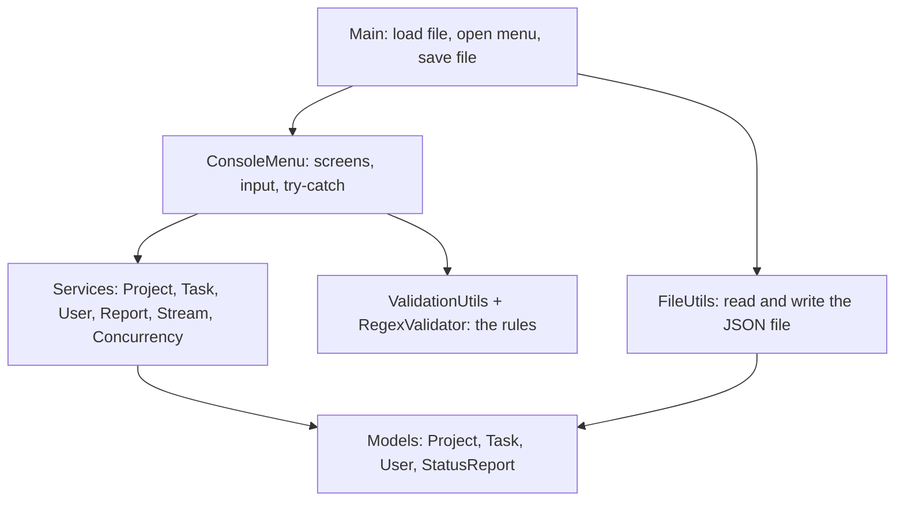

# Design decisions

Why the Lab 3 code looks the way it does. The Lab 2 decisions (layers, exceptions, SOLID) still apply and are summarised at the end.

## Class diagram

## Layers

## Collections

| Data | Collection | Why |
|---|---|---|
| projects | `HashMap<String, Project>` | the lab asks for it, and finding a project by ID is one lookup |
| tasks of a project | `ArrayList<Task>` | the lab asks for it, and tasks keep the order they were added |
| users | `ArrayList<User>` | few users, the first one is logged in at start |

- A `HashMap` has no order, so `getProjects()` sorts the projects by ID with a stream. The catalog is always in the same order.
- `getTasks()` and `getProjects()` return copies, so other classes cannot change the collections inside.
- `calculateCompletionPercentage()` still throws `EmptyProjectException` for a project without tasks (Lab 2). The lab's stream example uses `getCompletionRate()`, so this method gives 0 for a project without tasks, and streams can filter and sort on it.

## Functional programming

- **`TaskFilter`** is a functional interface: one method, `matches(Task)`. A filter is written as a lambda, for example `task -> !task.isCompleted()` in the simulation, or `TaskFilter.byStatus(...)`.
- **`StreamService`** answers questions about all the projects and tasks with streams: `filter` + `sorted` + `collect` (projects above 70%), `map` (task names), `reduce` (total completion).
- **`FunctionalUtils`** has `filter`, `map` and `validate(value, Predicate, message)`. `TaskService.addTask` uses `validate` with a `Predicate` to check that the task ID is not used yet (Workflow 2: regex first, then a functional check for uniqueness).
- Method references (`StatusReport::new`, `Task::getName`, `this::displayProjectRow`) are used where a lambda would only call one method.

## Regex

- All patterns are `Pattern` constants in `RegexValidator`: `P\d{3}`, `T\d{3}`, `U\d{3}`, email, whole number, decimal number. `matches()` uses a `Matcher`.
- A wrong ID throws `InvalidInputException` with the message of the lab: `Invalid Task ID format. Use pattern T### (e.g., T001)`.
- The check is also in the models (`Project`, `Task`), so an invalid ID cannot exist, whatever the way it was created (menu, file, test).
- IDs are now typed by the user, like in the lab example (`Enter new task ID:`). Nothing is converted: `1`, `t001` or `PRJ001` are refused, the user must type `T001`.

## File persistence

- **Save:** each project is turned into text with `map()` and the texts are joined with `Collectors.joining()`. `Files.writeString()` writes the result (US-3.1).
- **Confirm the write:** the lab asks to confirm a successful write (Workflow 3), so the file is read back with `Files.readString()` (US-3.1) and must be equal to what was written. `countProjects()` also reads it with `Files.lines()` inside a `try-with-resources` (Feature 3 functional reading, checklist), and must find as many projects as were saved.
- **Load on startup:** `Files.readAllLines()` reads the file (Feature 3), then the lines are trimmed and joined with a stream.
- **Reading the text:** the text is cut at each `{"projectId"`, so there is one piece per project. Inside a piece, a regex finds the tasks (`{ ... "id" ... }`) and another regex reads each `"key": value`. This keeps the reader short, without a JSON library.
- The lab names three read methods: `Files.readAllLines()`, `Files.lines()` and `Files.readString()`. Each one has its own job, so all three are used as the sheet asks.
- **Errors:** a missing file, a file that is not a list `[ ... ]`, or a missing field throws `DataFileException`. A bad value (for example a task ID `TX01`) throws `InvalidInputException`. `Main` catches both, shows `Unable to load projects_data.json (...)` and starts with an empty catalog.
- The budget, team size, hours and assignee are saved too, so a restart does not lose data. Every field is required when loading: a missing field is reported as malformed data, no value is invented.

## Concurrency

- `ConcurrencyService` moves tasks to their next status (Pending → In Progress → Completed) in two ways:
  - `updateWithThreads`: one `Thread` with a `Runnable` per task, then `join()` waits for all of them;
  - `updateWithParallelStream`: `parallelStream().forEach(...)`, Java chooses the threads.
- Each update waits 300 ms, so we can see the threads work at the same time.
- `ConcurrencyService` is the only service that prints: the progress lines (`Thread-1 updating T001 -> In Progress`) must be printed by the threads while they run.
- Thread safety with `synchronized` methods:
  - `countUpdate()`: `updatedCount++` is read, add, write; without `synchronized` two threads can lose an update. A test with 200 threads checks the count.
  - `Task.getStatus()`, `getStatusType()` and `setStatus()`.
  - `Project`: every method that uses the `ArrayList` of tasks.
  - `ProjectService`: every method that uses the `HashMap`.
  - `TaskService.addTask()`: "is the ID free?" and "add the task" must happen as one step.
- Like other task updates, the simulation is for admins.

## Tests

- `tests/` has only the 4 files of the lab structure, with the `*Test` names. `pom.xml` points Maven to `src/` and `tests/`.
- There is one test per requirement of the sheet (22 in total), each with a comment naming the requirement it checks. Variants of the same check (zero and negative budget, several wrong IDs) were removed: one test per rule is enough to prove it.
- The threading tests are in `TaskTest`, because the threads update tasks. The regex tests are in `TaskTest` (task IDs) and `ProjectTest` (project IDs).
- File tests use JUnit's `@TempDir`, so they never change `data/projects_data.json`.
- The lab's test example is used exactly as written: `t.getStatus().equals("Completed")`. That is why `getStatus()` returns the status as text, and `getStatusType()` returns the `Task.Status` value for the code that needs the next status or compares statuses.

## From Lab 2 (unchanged)

- Models hold and check the data, services do the work, `ValidationUtils` only has rules, `ConsoleMenu` reads the keyboard and prints.
- Single Responsibility: one job per class. Open/Closed: a new project type is a new subclass of `Project`, a new role is a new subclass of `User`.
- Typing mistakes are asked again; a failed operation shows the error and returns to the menu; `Main` closes the `Scanner` in `finally`.

## Next steps

- save the users too
- move from files to a database (Week 4)
